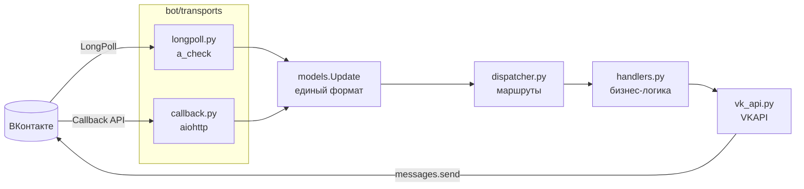

# 🤖 VK Bot

**Чат-бот ВКонтакте на Python. Одна бизнес-логика — два транспорта: LongPoll и Callback API.**

[](https://www.python.org/)
[](https://dev.vk.com/)
[](#-транспорты)
[](#-тесты)
[](#-стек)

Лёгкий каркас бота без «тяжёлых» фреймворков: только `httpx`, `aiohttp` и
`python-dotenv`. Транспорт приносит событие, диспетчер решает, кто его
обработает, хендлер отвечает — и ничего не знает о способе доставки.

---

## ✨ Возможности

- 🔁 **Два транспорта** — LongPoll для локального запуска, Callback API для продакшена.
- 🧠 **Единый диспетчер** — текст, payload-команды кнопок и произвольные предикаты.
- ⌨️ **Клавиатуры** — reply и inline, с удобными конструкторами.
- 🛡 **Надёжность** — авто-переподключение LongPoll (`failed: 1/2/3`), дедупликация
  событий по `event_id`, проверка `secret` у Callback API.
- 🔐 **Безопасность** — токен только в `.env`, в репозиторий не попадает.
- ✅ **Тесты без токена и сети** — 18 проверок логики и HTTP-сервера.

---

## 🏗 Архитектура



Транспорт превращает событие ВК в `Update` и вызывает `dispatcher.dispatch(...)`.
Дальше всё одинаково — поэтому переезд с LongPoll на Callback не требует
переписывать хендлеры.

---

## 🚀 Быстрый старт

```bash
git clone https://github.com/<ваш-логин>/vk-bot.git
cd vk-bot

python -m venv .venv
source .venv/Scripts/activate      # Linux/macOS: source .venv/bin/activate
pip install -r requirements.txt

cp .env.example .env               # заполнить VK_TOKEN и VK_GROUP_ID
python -m bot                      # по умолчанию LongPoll
```

Бот запустится и начнёт слушать сообщения сообщества.

---

## ⚙️ Настройки `.env`

| Переменная | Обязательна | По умолчанию | Назначение |
| --- | :---: | --- | --- |
| `VK_TOKEN` | ✅ | — | Ключ доступа сообщества |
| `VK_GROUP_ID` | ✅ | — | Числовой id сообщества (без минуса) |
| `BOT_TRANSPORT` | — | `longpoll` | `longpoll` или `callback` |
| `VK_API_VERSION` | — | `5.199` | Версия VK API |
| `VK_CONFIRMATION_CODE` | для Callback | — | «Строка, которую должен вернуть сервер» |
| `VK_SECRET_KEY` | для Callback | — | Секретный ключ из настроек сервера |
| `CALLBACK_HOST` | — | `0.0.0.0` | Адрес HTTP-сервера |
| `CALLBACK_PORT` | — | `8080` | Порт HTTP-сервера |
| `CALLBACK_PATH` | — | `/vk/callback` | Путь для событий |
| `LOG_LEVEL` | — | `INFO` | `DEBUG`, `INFO`, `WARNING`… |
| `LOG_HTTP` | — | `0` | `1` — показывать HTTP-запросы |

### Где взять токен и id

1. Создайте сообщество → **Управление → Работа с API**.
2. **Ключи доступа** → создайте ключ с правами «Управление сообществом» и
   «Сообщения сообщества». Это `VK_TOKEN`.
3. **ID сообщества** — числовой id без минуса (`VK_GROUP_ID`).
4. **Сообщения → Сообщения сообществ** — включить.
5. **Сообщения → Настройки для бота → Возможности ботов** — включить
   (без этого клавиатуры не отображаются!).
6. **Работа с API → Long Poll API** — включить, отметить `message_new`.
7. Для Callback API дополнительно отметить `message_event`.

---

## 🔌 Транспорты

### LongPoll — локальный запуск

```bash
python -m bot --transport longpoll
```

Дополнительная настройка не нужна: бот сам получает `server / key / ts`
и переподключается при `failed: 1/2/3`.

### Callback API — продакшен

Нужен публичный HTTPS-адрес. Локально удобно через туннель:

```bash
ngrok http 8080
# или: cloudflared tunnel --url http://localhost:8080
```

В сообществе: **Работа с API → Callback API → Настройки сервера**:

- URL — `https://<домен>/vk/callback`
- Строка подтверждения → `VK_CONFIRMATION_CODE` в `.env`
- Секретный ключ → `VK_SECRET_KEY` в `.env`
- Типы событий — `message_new`, `message_event`

```bash
python -m bot --transport callback
```

Сервер отвечает ВК `ok` сразу, обработка идёт в фоновой задаче; повторные
доставки отсекаются по `event_id`. Проверка живости — `GET /health`.

---

## ⌨️ Кнопки: два типа

| Тип | Где работает | Как приходит |
| --- | --- | --- |
| `text` — reply-клавиатура | LongPoll и Callback | `message_new`, payload в `message.payload` |
| `callback` — inline | только Callback API | событие `message_event` |

`build_dispatcher(inline_buttons=...)` переключает вид меню: в LongPoll `/help`
отдаёт reply-клавиатуру, в Callback API — inline. Нажатие `message_event`
проходит через тот же диспетчер, поэтому хендлеры общие.

> 💡 Reply-клавиатура живёт на **последнем** сообщении бота: ВК скрывает её,
> как только приходит ответ без `keyboard`. Вернуть — `/start` или `/help`.
> Чтобы клавиатура висела всегда, прикладывайте её явно:
> `await ctx.reply("...", keyboard=main_keyboard())`.

---

## 📁 Структура

```
bot/
  __main__.py          # CLI: python -m bot --transport longpoll|callback
  config.py            # настройки из .env
  models.py            # Update / ButtonEvent — события в одном формате
  dispatcher.py        # маршрутизация: текст, payload-команды, предикаты
  handlers.py          # вся бизнес-логика бота
  keyboards.py         # reply/inline клавиатуры
  vk_api.py            # единственный клиент API ВК
  transports/
    longpoll.py        # groups.getLongPollServer + a_check
    callback.py        # aiohttp-сервер Callback API
tests/
  test_dispatcher.py   # маршрутизация без сети
  test_callback.py     # HTTP-сервер на aiohttp TestClient
```

---

## 🧩 Свои команды

```python
@dp.message(text=["/ping", "пинг"])
async def ping(ctx: Context) -> None:
    await ctx.reply("pong")
```

Кнопка с payload:

```python
from .keyboards import button, keyboard

@dp.message(cmd="click")
async def on_click(ctx: Context) -> None:
    await ctx.reply("Кнопку нажали")

reply_markup = keyboard([[button("Нажми", payload={"cmd": "click"}, color="primary")]])
```

Хендлер получает `Context`:

- `ctx.update` — `text`, `peer_id`, `from_id`, `payload`, `command`;
- `ctx.reply(text, keyboard=..., attachment=..., reply_to=True)`.

Если ни один маршрут не совпал — срабатывает `@dp.fallback`.

---

## 🧪 Тесты

```bash
pip install -r requirements-dev.txt
python -m pytest -q
```

```
..................                                                       [100%]
18 passed
```

Тесты не требуют токена и не ходят в сеть: поднимают Callback-сервер через
`aiohttp.test_utils` и подменяют VK API заглушкой.

---

## 🧰 Стек

- **Язык:** Python 3.11+ (проверено на 3.13), `asyncio`
- **Сеть:** `httpx` — клиент VK API, `aiohttp` — сервер Callback API
- **ВКонтакте:** VK API 5.199, Bots LongPoll API, Callback API, клавиатуры
- **Тесты:** `pytest`, `pytest-asyncio`
- **Инфраструктура:** `python-dotenv`, Git

---

## ❗ Типичные проблемы

| Симптом | Причина и решение |
| --- | --- |
| Бот отвечает, но кнопок нет | Не включены **Возможности ботов** (Сообщения → Настройки для бота). Старые сообщения не обновятся — отправьте `/start` заново |
| Кнопки пропали после ответа | Норма: reply-клавиатура живёт на последнем сообщении. Вернуть — `/start` |
| Inline-кнопки не нажимаются | В LongPoll `message_event` не приходит. Нужен Callback API |
| `911 Keyboard format is invalid` | Некорректный JSON клавиатуры; проверьте, что это строка, а не dict |
| `15` / `27` при `getLongPollServer` | У токена нет прав «Управление сообществом» и «Сообщения сообщества» |
| Бот молчит на кнопку «Начать» | Приходит payload `{"command": "start"}` без текста — бот это понимает начиная с текущей версии |
| В логе одни 200-е | Это `httpx`; по умолчанию отключено, включается `LOG_HTTP=1` |

---

## 📦 Деплой

Callback API за reverse-proxy (nginx/caddy) с HTTPS, процесс — под systemd:

```ini
[Unit]
Description=VK bot
After=network-online.target

[Service]
WorkingDirectory=/opt/vk-bot
EnvironmentFile=/opt/vk-bot/.env
ExecStart=/opt/vk-bot/.venv/bin/python -m bot --transport callback
Restart=always
RestartSec=3

[Install]
WantedBy=multi-user.target
```

---

## 🗺 План

- [x] LongPoll + Callback API на общей логике
- [x] Клавиатуры и payload-команды
- [x] Тесты без сети
- [ ] GitHub Actions: тесты на каждый push
- [ ] SQLite для состояния между перезапусками
- [ ] Docker + docker-compose
- [ ] Сценарии вместо эха: заявки, каталог, запись

---

<p align="center">
  <sub>Сделано на Python · VK API 5.199 · без vkbottle</sub>
</p>
